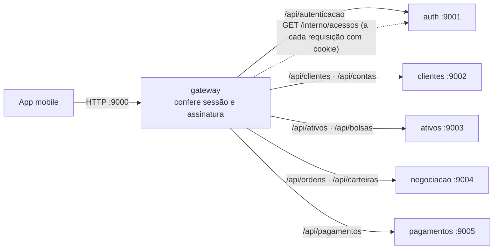
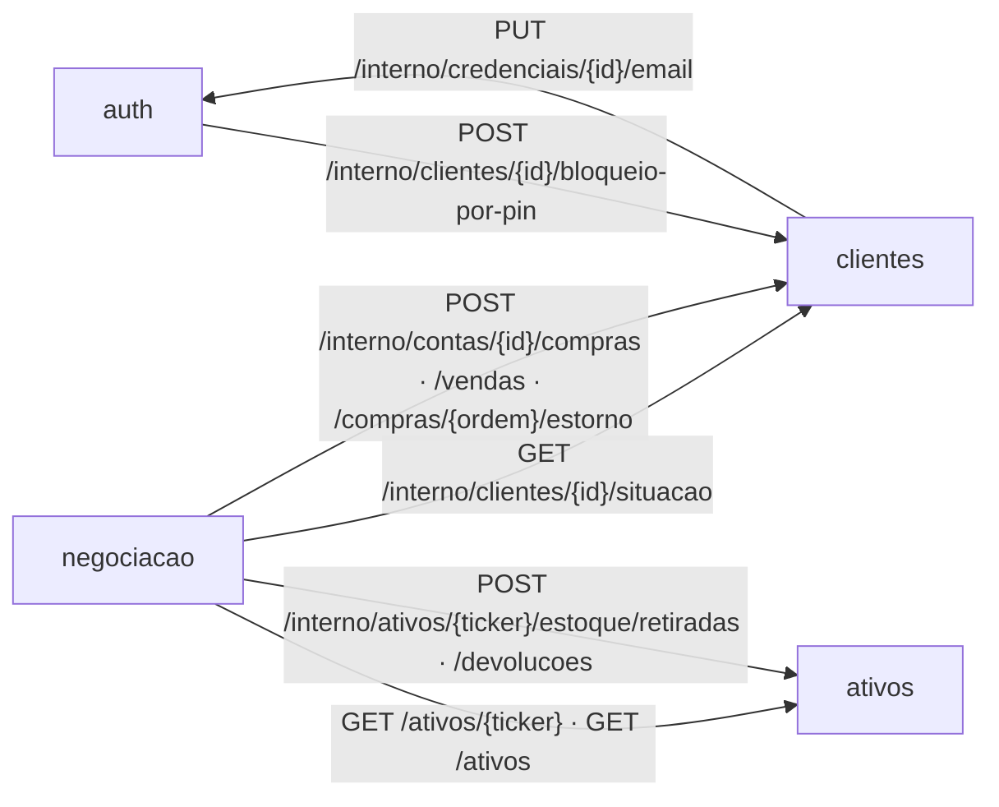
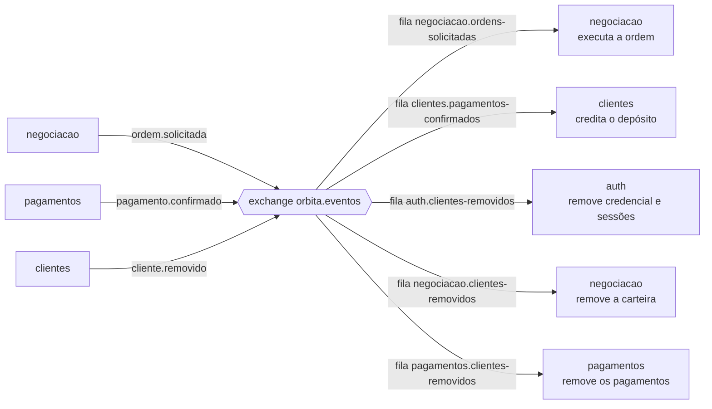
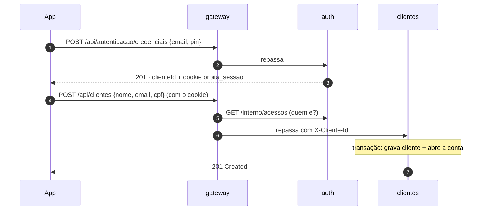
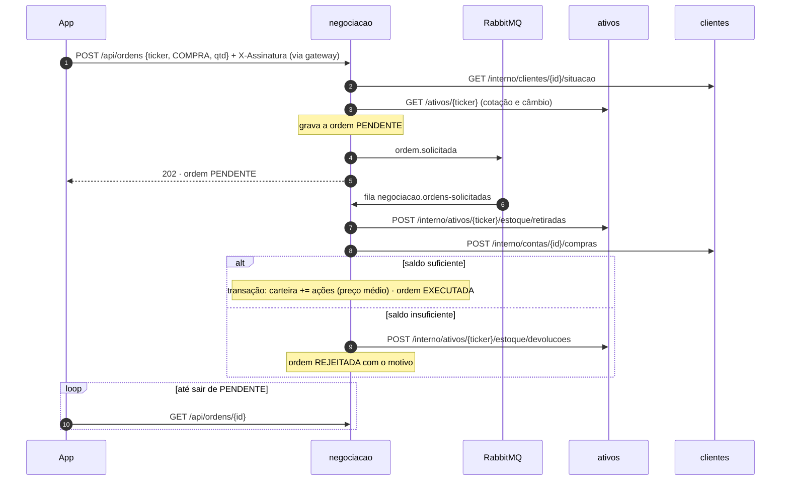
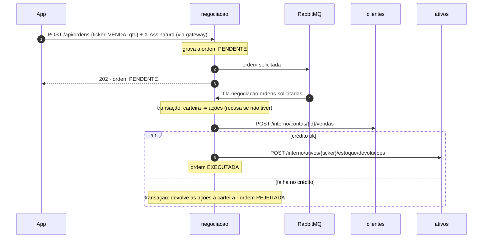
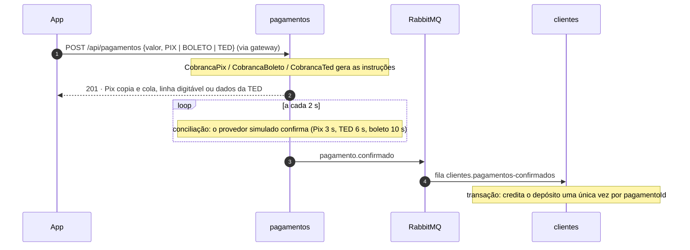

# Comunicação entre os serviços

Existem três formas de comunicação no OrbitaPay:

| Forma | Quem usa | Como funciona |
|---|---|---|
| **HTTP público** | app → gateway → serviço | O app só conhece o gateway (porta 9000). O gateway confere o acesso e repassa para o serviço dono da rota. |
| **HTTP interno** | serviço → serviço | Quando um serviço precisa de uma resposta na hora. As rotas começam com `/interno/` e não passam pelo gateway. |
| **Evento (RabbitMQ)** | serviço → exchange `orbita.eventos` → filas | Quando o trabalho pode acontecer depois e não pode se perder, ou quando vários serviços reagem ao mesmo fato. |

Cada serviço acessa **somente o seu próprio MongoDB**. Se precisa de um dado de outro serviço, pede pelo ID.

## 1. App → gateway → serviços

## 2. Chamadas HTTP entre serviços

## 3. Eventos no RabbitMQ

| Evento | Publica | Fila | Consome | Para quê |
|---|---|---|---|---|
| `ordem.solicitada` | negociacao | `negociacao.ordens-solicitadas` | negociacao | executar a ordem em segundo plano (só se ainda estiver `PENDENTE`) |
| `pagamento.confirmado` | pagamentos | `clientes.pagamentos-confirmados` | clientes | creditar o depósito (uma única vez por `pagamentoId`) |
| `cliente.removido` | clientes | `auth.clientes-removidos` | auth | apagar a credencial e as sessões |
| `cliente.removido` | clientes | `negociacao.clientes-removidos` | negociacao | apagar a carteira |
| `cliente.removido` | clientes | `pagamentos.clientes-removidos` | pagamentos | apagar os pagamentos do cliente |

Se o consumo de uma mensagem falhar 3 vezes, ela vai para a fila `<fila>.erro` em vez de ficar em loop.

## 4. Cadastro de cliente

Se o cadastro for recusado (CPF inválido, e-mail repetido), o app desfaz a credencial com `DELETE /api/autenticacao/credenciais/me`, permitido até 10 minutos depois da criação.

## 5. Compra de ações

## 6. Venda de ações

## 7. Depósito

